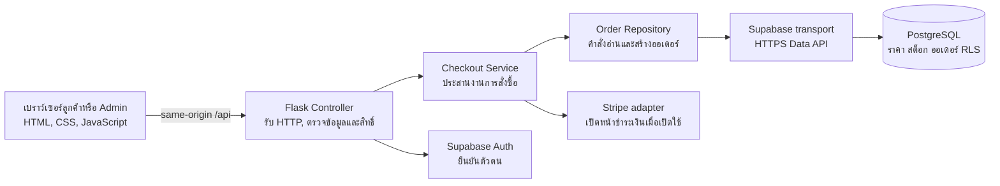
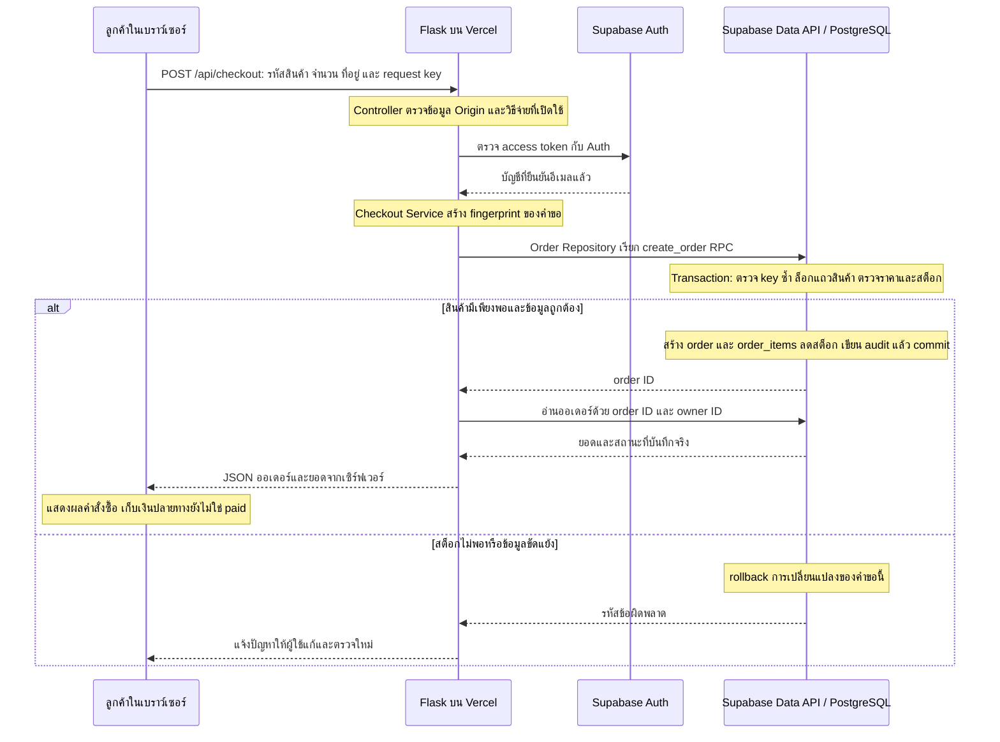
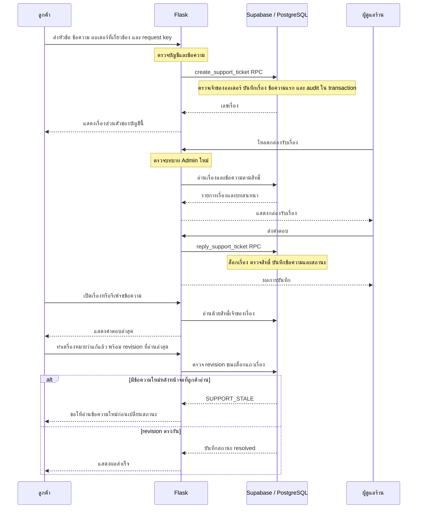

# Alyzyus: โครงสร้างที่อธิบายจากโค้ดจริง

Alyzyus เป็นต้นแบบร้านค้าออนไลน์ของร้านเดียวที่ขายสินค้าหลายหมวด มีผู้ใช้สองกลุ่มคือ ลูกค้าและผู้ดูแลร้าน
เป้าหมายด้านซอฟต์แวร์คือให้ทั้งสองฝั่งใช้ข้อมูลสินค้าและคำสั่งซื้อชุดเดียวกัน พร้อมฝึกการแบ่งหน้าที่ของโค้ดและดูแลข้อมูลเมื่อมีคำขอพร้อมกัน
ยังไม่มีหลักฐานว่าระบบลดเวลาทำงานของร้านจริงหรือรองรับผู้ใช้จำนวนมากแล้ว จึงควรเรียกโจทย์ธุรกิจนี้ว่าโจทย์จำลองเพื่อการเรียนรู้

## ภาพรวมการทำงาน

กล่องหลายกล่องภายใน Flask คือการแบ่งไฟล์และความรับผิดชอบในเซิร์ฟเวอร์เดียว ไม่ได้หมายถึงแยกเป็นหลาย microservice
Vercel รันเว็บและ Python function ส่วน Supabase ดูแล Auth, PostgreSQL และที่เก็บรูปสินค้า
เบราว์เซอร์เรียก `/api` ของ Flask ไม่ได้รับ server key และไม่เชื่อม PostgreSQL ด้วยตนเอง

## แบ่งหน้าที่อย่างไร

- **View:** `templates/` กับ `public/static/` แสดงหน้าจอ ฟอร์ม และผลลัพธ์ หน้า HTML บางส่วนใช้ Jinja สร้างจากฝั่งเซิร์ฟเวอร์
- **Controller:** `server/api.py` รับคำขอเช็กเอาต์ ตรวจรูปแบบข้อมูล บัญชีและวิธีชำระเงิน แล้วส่งให้ service ก่อนแปลงผลเป็น JSON
- **Application service:** `server/services/checkout.py` ประสานการสร้างออเดอร์ การอ่านผลที่บันทึกแล้ว และการเตรียมขั้นตอนชำระเงิน โดยไม่อ่าน Flask request หรือ cookie เอง
- **Repository:** `server/repositories/orders.py` ตั้งชื่อการเข้าถึงข้อมูลให้สัมพันธ์กับงาน เช่น `create()` และ `for_owner()` การอ่านแบบ privileged ระบุทั้ง order ID และ owner ID และจำกัดหนึ่งรายการ
- **Transport:** `server/database.py` ส่ง HTTPS ไป Supabase จัดการ header, timeout และ provider errors ร่วมกัน
- **Model และกฎข้อมูล:** ตาราง ข้อจำกัด RLS และ SQL functions ใน `supabase/migrations/` โดยเฉพาะการคำนวณยอดและตัดสต็อกแบบ atomic
- **ส่วนประกอบเฉพาะงาน:** `auth.py`, `validation.py`, `payments.py`, `support.py` และ `audit.py` ดูแลหน้าที่ของตน

เรียกโครงสร้างนี้ว่า **Layered Architecture ที่แยกหน้าที่แบบ MVC** ได้ โดยต้องบอกขอบเขตตามจริง:
การแยก Controller, Service และ Repository ชัดเจนใน use case เช็กเอาต์ก่อน ส่วน route อื่นบางส่วนยังเรียก transport เดิม
ไม่ได้ย้ายทุก route เข้ารูปแบบเดียวกัน และไม่ได้ใช้ ORM

การที่ backend อ่านฐานข้อมูลเป็นเรื่องปกติ ปัญหาที่ควรหลีกเลี่ยงคือให้ UI ผูกกับ schema และกฎธุรกิจมากเกินไป
หรือส่งสิทธิ์เซิร์ฟเวอร์ไปให้ browser การปรับครั้งนี้ลดการผูก route เช็กเอาต์กับรายละเอียดฐานข้อมูล และทำให้ทดสอบ use case ด้วย fake repository ได้

## Sequence การสั่งซื้อแบบเก็บเงินปลายทาง

อ่านจากบนลงล่าง แต่ละคอลัมน์คือผู้รับผิดชอบ ลูกศรคือคำขอหรือผลตอบกลับ
ภาพนี้แสดงระบบจริงเมื่อฐานข้อมูลและบัญชีตั้งค่าพร้อม โหมดสาธิตสำหรับ portfolio แยกจากธุรกรรมจริง

รายการที่ browser ส่งไม่ได้เป็นหลักฐานราคาที่เชื่อถือได้ PostgreSQL อ่านราคาสินค้าจากข้อมูลที่ร้านกำหนด และคำนวณคูปองกับค่าจัดส่งเอง
ถ้าเกิด timeout แล้วผู้ใช้ส่ง **คำขอเดิมและ key เดิม** อีกครั้ง ระบบคืนออเดอร์เดิม
ถ้าใช้ key เดิมแต่เปลี่ยนเนื้อหา ระบบปฏิเสธเพื่อไม่ให้ความหมายของคำขอกำกวม

บัตรและ PromptPay มีส่วนต่อท้ายคือ service เปิด Stripe Checkout หลัง transaction ออเดอร์สำเร็จ
ระบบยืนยันสถานะจ่ายจาก webhook ที่ตรวจลายเซ็นและตรวจยอดแล้ว ไม่ใช้การกลับมายัง success URL เป็นหลักฐาน
การเรียก Stripe กับ PostgreSQL เป็นคนละระบบและไม่ได้อยู่ใน transaction เดียวกัน โค้ดใช้ idempotency, retry และ webhook เพื่อลดผลซ้ำ ส่วนงานตรวจยอดค้างและกระทบยอดอัตโนมัติยังต้องพัฒนาก่อนเปิดรับเงินจริงเต็มรูปแบบ

## ทำไมต้องล็อกสินค้า

สมมติสินค้าคงเหลือ 1 ชิ้น ลูกค้า A และ B สั่งในเวลาใกล้กัน:

1. คำขอ A ล็อกแถวสินค้านั้นด้วย `FOR UPDATE` แล้วตรวจว่ามี 1 ชิ้น
2. A สร้างออเดอร์ ลดคงเหลือเป็น 0 และ commit จากนั้นปล่อย lock
3. คำขอ B ที่ต้องแก้แถวเดียวกันรอ A ก่อน แล้วตรวจเห็นว่าคงเหลือ 0
4. B ได้ `OUT_OF_STOCK` การเปลี่ยนแปลงของคำขอ B ถูก rollback

ล็อกนี้ป้องกันการขายชิ้นสุดท้ายให้สองคน ไม่ได้ปิดการใช้งานฐานข้อมูลทั้งก้อน
ระบบล็อกแถวสินค้าตามลำดับ UUID เดียวกันเพื่อลดโอกาส deadlock
ยังมี advisory transaction locks สำหรับคำขอของผู้ซื้อและ idempotency เพื่อจัดลำดับการ retry คูปองแรกเข้า และ quota ของบัญชีเดียวกัน

ตัวอย่างเป็นเหตุผลเชิงตรรกะของกลไก ไม่ใช่ผล benchmark หรือข้ออ้างว่าไม่มี deadlock ได้ทุกกรณี
ดูโค้ดต้นทาง `202610110001_commerce.sql` โดย implementation ถูกย้ายไป schema `private` ผ่าน migration ถัดมา

## Sequence บริการลูกค้า

บริการนี้เป็นระบบคำร้องและบทสนทนาส่วนตัว ยังไม่มี live chat แบบ WebSocket และไม่มีพนักงานจริงตอบรับประกันตลอด 24 ชั่วโมง

## เหตุผลที่เลือกเครื่องมือ

- **Python และ Flask:** ใช้ภาษาที่ต้องการเรียนรู้ รวม route, JSON API และ Jinja ในแอปขนาดนี้ได้ โดยไม่ต้องเพิ่ม frontend build pipeline
- **HTML, CSS และ JavaScript:** เห็นการทำงานของ form, DOM, fetch และ browser storage โดยตรง เหมาะกับการฝึกพื้นฐานและลด dependency ฝั่งลูกค้า
- **Supabase PostgreSQL:** ใช้ความสัมพันธ์ของ order กับ order_items, transaction และ row locks พร้อม RLS คุมข้อมูลที่แต่ละบัญชีอ่านได้
- **Supabase Auth/Storage:** ใช้บริการยืนยันตัวตนและเก็บรูปสินค้า แทนการเก็บรหัสผ่านเองหรือเขียนระบบไฟล์ใหม่ทั้งหมด
- **Vercel:** เผยแพร่ HTTPS และ Python endpoint ได้จากโปรเจกต์นี้ ยังต้องเข้าใจ cold starts, environment และข้อจำกัดของบริการฐานข้อมูลที่พึ่งพา
- **Three.js:** อธิบายขั้นตอนสถานะออเดอร์ด้วยภาพ 3D รูปทรงเรียบง่าย ความเคลื่อนไหวไม่ใช่หลักฐานว่าพัสดุเดินทางจริง

การเลือกนี้เป็น trade-off ที่เหมาะกับขอบเขตการเรียนรู้ ยังไม่มีข้อมูลทดสอบยืนยันว่าเป็น stack ที่เร็วที่สุด
PWA คือเว็บที่ติดตั้งทางลัดและเปิดเป็นหน้าต่างแอปได้ตามความสามารถของ browser ไม่ใช่หลักฐานว่ามี native iOS/Android app หรือขึ้น App Store แล้ว

## สิ่งที่ควรแสดงใน portfolio

เรื่องหลักคือฝั่งลูกค้า ฝั่งผู้ดูแล การสร้างออเดอร์ที่เชื่อถือได้ และวงจรบริการลูกค้า
ฟีเจอร์ภาษา ธีม PWA และภาพ 3D เป็นส่วนเสริมของประสบการณ์ใช้งาน
ตัดสำนักงานคณะ แบบจำลองคิวนักศึกษา Poisson และบททดลองจำนวนอาจารย์ออกจากเรื่องเล่า e-commerce
ส่วนนี้เป็นงานทดลองคนละโจทย์และไม่จำเป็นต่อการอธิบายร้าน Alyzyus

แยกสิ่งที่ **ทำได้ในต้นแบบ** ออกจากสิ่งที่ **ต้องตั้งค่าก่อนเปิดธุรกิจจริง** เช่นบัญชีรับเงิน SMTP นโยบายร้าน การคืนเงิน และการขนส่ง
ไม่ควรอ้างว่ามีลูกค้า รายได้ หรือผลประหยัดเวลาจริงโดยไม่มีหลักฐาน

## ทดสอบการแยกชั้นนี้

`tests/test_checkout_service.py` ใช้ fake repository, mapper และ payment adapter ไม่เปิด Flask app/request context และไม่เรียก network
ตรวจ fingerprint เมื่อสลับลำดับสินค้า ข้อมูลยอดจากออเดอร์ที่บันทึกแล้ว การ retry ออเดอร์ paid การปฏิเสธ cancelled และการไม่เปิด payment เมื่อสร้างออเดอร์ล้มเหลว
ส่วน HTTP และ transaction/RLS ยังตรวจด้วยชุดทดสอบเดิม เพราะ unit test ของ service อย่างเดียวพิสูจน์ความถูกต้องของฐานข้อมูลไม่ได้

## เอกสารต้นทาง

- [Flask design decisions](https://flask.palletsprojects.com/en/stable/design/): Flask ให้แอปเลือกโครงสร้างและการเชื่อมฐานข้อมูลเอง
- [PostgreSQL explicit locking](https://www.postgresql.org/docs/current/explicit-locking.html): ความต่างระหว่าง row locks และ advisory locks รวมถึงขอบเขต transaction
- โค้ดประกอบคำอธิบาย: `server/api.py`, `server/services/checkout.py`, `server/repositories/orders.py`, `server/database.py`, `server/support.py` และ migrations ใน repository นี้
